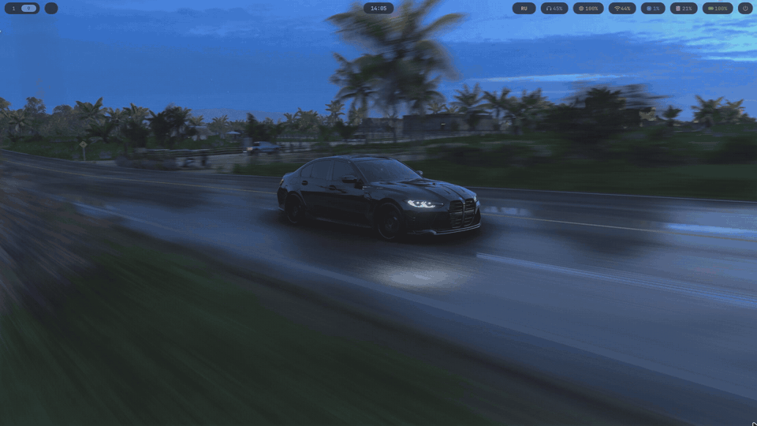
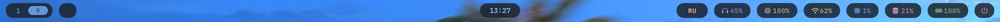
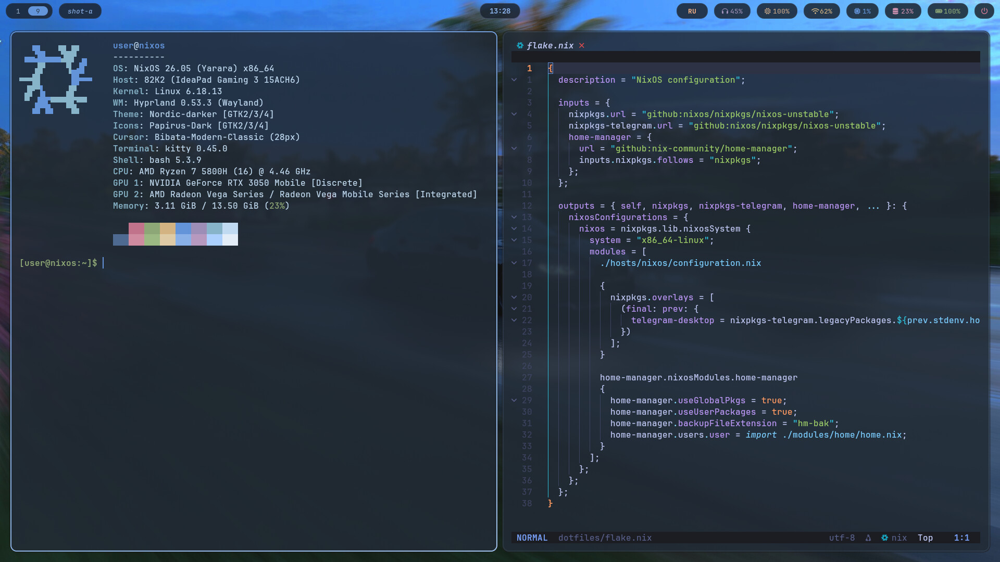
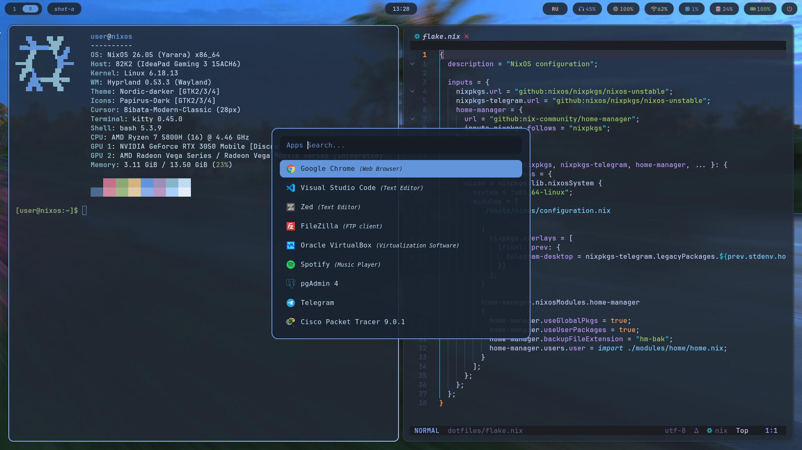
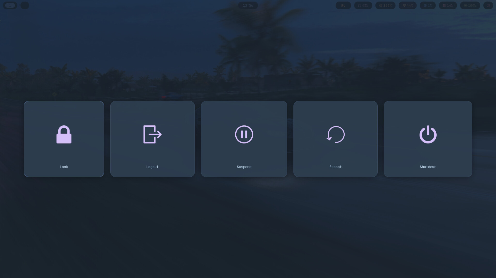
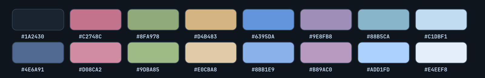

<div align="center">

# ❄️ dotfiles

**A declarative NixOS desktop: Hyprland + Waybar + Rofi + Kitty + AstroNvim, all wearing one palette pulled from a single wallpaper.**


[](https://github.com/am1rqr/dotfiles/actions/workflows/check.yml)




</div>

> Captured on the built-in 1920×1080 @ 120 Hz laptop panel (Lenovo IdeaPad Gaming 3, Ryzen 7 5800H, RTX 3050 Mobile).

## Highlights

- **One palette everywhere.** *BMW Dusk* is extracted from the wallpaper and shared by Kitty, Waybar, Rofi, hyprlock, wlogout, Zed, qimgv and Hyprland borders.
- **One rebuild does it all.** Home Manager runs as a NixOS module, so system and user config land together.
- **Boot to desktop without a login screen.** greetd auto-starts Hyprland, which immediately launches hyprlock, so the lock screen is the only gate. Plymouth plays a custom animated radar splash first.
- **Laptop + external monitor aware.** The lock screen wrapper picks the HDMI output when present and falls back to the laptop panel.
- **Small, split modules.** Hyprland, Waybar and Rofi are broken into one file per concern, easy to lift into your own config.
- **Lean editor setup.** AstroNvim starts LSP servers lazily and inherits the terminal's transparency; Zed is configured for instant startup.

## Gallery



## Gallery

| Terminal + editor | Launcher |
| :---: | :---: |
|  |  |

| Power menu |
| :---: |
|  |

### Palette



## What's inside

| Component | Choice |
| --- | --- |
| OS | NixOS (unstable), flakes |
| User config | Home Manager **as a NixOS module** (one rebuild does both) |
| Compositor | [Hyprland](https://hyprland.org) via UWSM, split into small modules (binds, animations, rules, …) |
| Login | greetd autologin → hyprlock is the actual gate |
| Lock screen | hyprlock, picks the external monitor when present, falls back to the laptop panel |
| Bar | Waybar, one file per module + CSS split into base / colors / workspaces / modules |
| Launcher | Rofi with the [adi1090x](https://github.com/adi1090x/rofi) launcher collection, retinted to the shared palette |
| Terminal | Kitty, 85 % opacity, JetBrainsMono Nerd Font |
| Editor | [AstroNvim](https://astronvim.com) (lazy LSP, transparent UI) and Zed |
| Power menu | wlogout |
| Wallpaper | swww |
| Boot | Plymouth with a custom animated "radar" theme, silent boot |
| Theme | **BMW Dusk**: a palette extracted from the wallpaper, reused in Kitty, Waybar, Rofi, hyprlock, Zed, qimgv, GTK (Nordic-darker, Papirus-Dark, Bibata) |

## Layout

```
.
├── flake.nix                     # nixpkgs (unstable) + home-manager, one host: `nixos`, `username` lives here
├── hosts/nixos/
│   ├── configuration.nix         # boot, network, Hyprland, greetd, audio, Docker, fonts, packages
│   ├── hardware-configuration.nix
│   ├── plymouth.nix              # boot splash theme
│   └── plymouth/radar/           # animation frames + script
└── modules/
    ├── home/
    │   ├── home.nix              # entry point: packages, bash, Zed, GTK, cursor
    │   ├── hyprland/             # binds, animations, windowrules, monitors, ...
    │   ├── waybar/               # layout + modules/ + style/
    │   ├── rofi/                 # launchers, colors, theme
    │   ├── kitty/  hyprlock/  wlogout/  qimgv/  zed/  nvim/
    │   └── ncalayer/             # optional Kazakhstan e-signature client
    └── system/                   # ncalayer option, Cisco Packet Tracer package
```

## Keybinds (highlights)

`Super` is the main modifier.

| Keys | Action |
| --- | --- |
| `Super + Return` | Terminal |
| `Super + D` / `Super + R` | App launcher |
| `Super + E` | File manager (Thunar) |
| `Super + Q` | Close window |
| `Super + F` | Fullscreen |
| `Super + V` | Toggle floating |
| `Super + 1…0` | Switch workspace |
| `Super + Shift + 1…0` | Move window to workspace (silently, focus stays) |
| `Super + S` | Scratchpad |
| `Super + C` | Screenshot of the focused monitor |
| `Super + Shift + C` | Screenshot of a selected region |
| `Alt + Shift` | Switch keyboard layout (us / ru) |

Full list: [`modules/home/hyprland/binds.nix`](modules/home/hyprland/binds.nix).

## Take only what you like

You don't have to adopt the whole system. Most pieces are self-contained and can be copied on their own:

| Want | Look at |
| --- | --- |
| The bar | [`modules/home/waybar/`](modules/home/waybar) |
| The launcher theme | [`modules/home/rofi/`](modules/home/rofi) |
| Hyprland split into small files | [`modules/home/hyprland/`](modules/home/hyprland) |
| Lock screen with monitor auto-pick | [`modules/home/hyprlock/default.nix`](modules/home/hyprlock/default.nix) |
| Plymouth boot animation | [`hosts/nixos/plymouth.nix`](hosts/nixos/plymouth.nix) |
| Terminal palette | [`modules/home/kitty/colors.nix`](modules/home/kitty/colors.nix) |
| Editor theme for Zed | [`modules/home/zed/themes/bmw-dusk.json`](modules/home/zed/themes/bmw-dusk.json) |

## Install

> You need a machine already running NixOS with flakes enabled. Read the config before you apply it: it is tailored to one laptop.

```bash
git clone https://github.com/am1rqr/dotfiles ~/dotfiles
cd ~/dotfiles

# 1. Replace the hardware profile with your own
sudo nixos-generate-config --show-hardware-config > hosts/nixos/hardware-configuration.nix

# 2. Adjust what is machine-specific (see the checklist below)

# 3. Build and switch
sudo nixos-rebuild switch --flake .#nixos
# or, with nh:  nh os switch
```

Home Manager is wired in as a NixOS module, so there is no separate `home-manager switch`.

### Make it yours

- **Username**: set `username` at the top of [`flake.nix`](flake.nix). Home directory and paths follow from it.
- **Monitors**: edit [`modules/home/hyprland/monitors.nix`](modules/home/hyprland/monitors.nix) (`eDP-1` laptop panel, `HDMI-A-1` external).
- **Lock screen name and avatar**: [`modules/home/hyprlock/default.nix`](modules/home/hyprlock/default.nix).
- **NCALayer**: a Kazakhstan e-signature client, controlled by `custom.ncalayer.enable` in `configuration.nix`. Set it to `false` (or remove the line) if you don't need it; if you do, see [`modules/home/ncalayer/README.md`](modules/home/ncalayer/README.md) for the vendor files you must provide.
- **Cisco Packet Tracer**: the package needs the installer `.deb` from Cisco (`requireFile`). Remove the `cisco-packet-tracer-901.nix` line from `systemPackages` unless you have it.
- **Time zone, locale, packages**: `hosts/nixos/configuration.nix`.

## Useful commands

```bash
nh os switch            # rebuild and switch, shows a package diff
nh os boot              # rebuild for next boot (needed for some services)
nix flake check         # evaluate without applying
nix flake update        # bump nixpkgs and home-manager
```

Old generations are cleaned weekly by `programs.nh.clean` (keeps the last 20 and everything from the past 14 days).

## Credits

- Rofi launcher styles: [adi1090x/rofi](https://github.com/adi1090x/rofi) (GPL-3.0, license copy in [`modules/home/rofi/LICENSE-adi1090x`](modules/home/rofi/LICENSE-adi1090x)).
- [Hyprland](https://hyprland.org), [Home Manager](https://github.com/nix-community/home-manager), [AstroNvim](https://astronvim.com), [Waybar](https://github.com/Alexays/Waybar).
- The wallpaper is used under its own license and is not covered by this repository's MIT license.

## License

[MIT](LICENSE) for the original configuration. Third-party material keeps its own license (see Credits).
